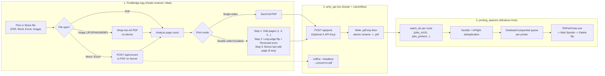

# PrintBridge

**PrintBridge** is a lightweight remote-printing bridge that centralizes printer management in one place and turns any printer connected to a Windows PC into a remotely accessible network printer from Android phones or web browsers.

### Why PrintBridge?
Many printers (especially budget USB, thermal, or older GDI models) only ship official drivers for **Windows** and lack proper Linux/CUPS, Android, or AirPrint support. Instead of fighting with missing drivers on mobile devices or Linux homelabs, PrintBridge **leverages a Windows host as a driver execution bridge**:
- Your Android phone or browser sends print jobs over the network to a lightweight **Go API (`print_api`)**.
- The API drops ready-to-print PDFs into per-printer watch folders.
- A **Windows daemon (`printing_daemon`)** picks them up and prints through the **native Windows printer drivers** installed on that PC.

---

## Architecture & Workflow



### Key Design Highlights
- **Zero Database / Queue Overhead:** `print_api` names files with `<timestamp>_<seq>_<filename>.pdf` and writes atomically (`.tmp` → `.pdf`). `printing_daemon` maintains a dedicated `chan printJob` worker per printer (sequential per printer, parallel across different printers).
- **Safe Error Handling:** If file readiness checks or printing fails, `printing_daemon` leaves the PDF intact in the watch folder (never deletes an unprinted file) and keeps processing subsequent jobs.
- **Guided Manual Duplex Printing:** `PrintBridge` splits multi-page PDFs into odd pages, reversed even pages, and an optional last odd page, with a locked step-by-step workflow and a 3D long-edge paper-flip guide.

---

## Project Structure

```text
PrintBridge/
├── .github/workflows/build.yml   # GitHub Actions CI/CD for all 3 components
├── print_app/                    # Flutter Android & Web client (PrintBridge)
├── print_api/                    # Go net/http API + Docker + LibreOffice headless
└── printing_daemon/              # Go Windows multi-folder print daemon
```

---

## Automated Builds (GitHub Actions)

Every push to `main` (or manual `workflow_dispatch`) runs [.github/workflows/build.yml](.github/workflows/build.yml) to build all 3 components:
1. **`printing-daemon-windows` artifact:** `printer_agent.exe`, `config.json`, `build.bat`.
2. **`print_api` Docker image:** multi-arch (`linux/amd64`, `linux/arm64`) pushed to `ghcr.io/vuhaipro2707/printbridge-api:latest`.
3. **`printbridge-android-arm64` artifact:** `PrintBridge-arm64.apk`.
   - *(Optional)* Set `PRINT_API_URL` as a GitHub Repository Variable and `PRINT_API_KEY` as a Repository Secret to bake defaults into CI-built APKs (you can also configure them anytime inside the app).
4. **GitHub Releases:** Pushing a tag such as `git tag v1.0.0 && git push origin v1.0.0` automatically creates a GitHub Release with `PrintBridge-arm64.apk` and `printer_agent.exe` attached.

---

## Deployment & Manual Build Guide

### 1. `printing_daemon` (Windows PC with Printers Attached)
1. Download `printer_agent.exe` from GitHub Actions/Releases, or build it yourself:
   - On Windows: run `printing_daemon/build.bat`.
   - Cross-compile from macOS/Linux:
     ```bash
     cd printing_daemon
     GOOS=windows GOARCH=amd64 go build -o printer_agent.exe main.go
     ```
2. Edit `printing_daemon/config.json` to map each `watch_dir` to its `target_printer` name in Windows (`delete_after_print` defaults to `true`).
3. Place `PDFtoPrinter.exe` alongside `printer_agent.exe` (or set `pdf_to_printer_path` in `config.json`; PowerShell `Start-Process -Verb PrintTo` is used as fallback).

### 2. `print_api` (Docker / Homelab)
Create a `docker-compose.yml` on your server alongside your `config.json`:

```yaml
services:
  print_api:
    image: ghcr.io/vuhaipro2707/printbridge-api:latest
    # Or build locally from ./print_api:
    # build: ./print_api
    container_name: print_api
    ports:
      - "8080:8080"
    environment:
      - LISTEN_ADDR=:8080
      - API_KEY=${API_KEY:-}
    volumes:
      - ./config.json:/app/config.json:ro
      - /path/to/jobs_m115:/printing_daemon/jobs_m115
      - /path/to/jobs_printer2:/printing_daemon/jobs_printer2
    restart: unless-stopped
```

Then start it:
```bash
docker compose up -d
```

#### `print_api` Endpoints
| Method | Endpoint | Description |
| :--- | :--- | :--- |
| `GET` | `/health` | Health status and auth mode (public) |
| `GET` | `/api/routes` | Lists configured printers/routes and current `pending_count` |
| `POST` | `/api/convert` | Converts `.doc`, `.docx`, `.xls`, `.xlsx` to PDF via LibreOffice |
| `POST` | `/api/print` | Accepts `route` + `file` (`.pdf` or Office) and queues it for printing |

### 3. `print_app` (Flutter Android & Web)
1. Create `.env` from the example template:
   ```bash
   cp print_app/.env.example print_app/.env
   ```
   Set `PRINT_API_URL` (e.g., `http://192.168.1.182:8080` for physical devices on LAN, `http://10.0.2.2:8080` for Android Emulator) and `PRINT_API_KEY` if enabled.
2. **Run in debug mode:**
   ```bash
   cd print_app
   flutter pub get

   # Android / Emulator
   flutter run --dart-define-from-file=.env

   # Chrome (Web)
   flutter run -d chrome --dart-define=PRINT_API_URL=http://localhost:8080
   ```
3. **Build 64-bit (`arm64`) Release APK locally:**
   ```bash
   cd print_app
   flutter build apk --release --target-platform android-arm64 --dart-define-from-file=.env
   ```
