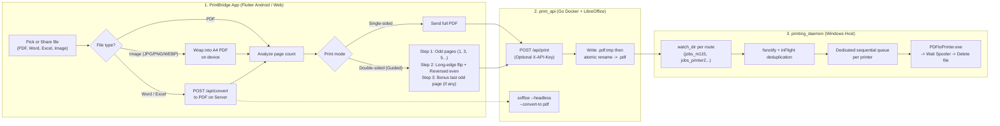

# PrintBridge

**PrintBridge** is a lightweight remote-printing bridge that centralizes printer management in one place and turns any printer connected to a Windows PC into a remotely accessible network printer from Android phones or web browsers.

### Why PrintBridge?
Many printers (especially budget USB, thermal, or older GDI models) only ship official drivers for **Windows** and lack proper Linux/CUPS, Android, or AirPrint support. Instead of fighting with missing drivers on mobile devices or Linux homelabs, PrintBridge **leverages a Windows host as a driver execution bridge**:
- Your Android phone or browser sends print jobs over the network to a lightweight **Go API (`print_api`)**.
- The API drops ready-to-print PDFs into per-printer watch folders.
- A **Windows daemon (`printing_daemon`)** picks them up and prints through the **native Windows printer drivers** installed on that PC.

---

## Architecture & Workflow



### Key Design Highlights
- **Zero Database / Queue Overhead:** `print_api` names files with `<timestamp>_<seq>_<filename>.pdf` and writes atomically (`.tmp` → `.pdf`). `printing_daemon` maintains a dedicated `chan printJob` worker per printer (sequential per printer, parallel across different printers).
- **Safe Error Handling:** If file readiness checks or printing fails, `printing_daemon` leaves the PDF intact in the watch folder (never deletes an unprinted file) and keeps processing subsequent jobs.
- **Guided Manual Duplex Printing:** `PrintBridge` splits multi-page PDFs into odd pages, reversed even pages, and an optional last odd page, with a locked step-by-step workflow and a 3D long-edge paper-flip guide.

---

## Project Structure

```text
PrintBridge/
├── print_app/          # Flutter Android & Web client (PrintBridge)
├── print_api/          # Go net/http API + Docker + LibreOffice headless
└── printing_daemon/    # Go Windows multi-folder print daemon
```

---

## Configuration & Build Guide

### 1. `printing_daemon` (Windows PC with Printers Attached)
1. Edit `printing_daemon/config.json` to map each `watch_dir` to its `target_printer` name in Windows:
   - `delete_after_print`: defaults to `true`.
2. Place `PDFtoPrinter.exe` alongside the executable (or set `pdf_to_printer_path` in `config.json`; PowerShell `Start-Process -Verb PrintTo` is used as fallback).
3. **Build on Windows:** run `build.bat` to produce `printer_agent.exe`.
   - Or **cross-compile from macOS/Linux:**
     ```bash
     cd printing_daemon
     GOOS=windows GOARCH=amd64 go build -o printer_agent.exe main.go
     ```

### 2. `print_api` (Docker / Homelab)
1. Configure `print_api/config.json` with your `routes` (`id`, `name`, `watch_dir`) matching the folders watched by `printing_daemon`.
2. Update `print_api/docker-compose.yml`:
   - Adjust the `volumes` paths if `print_api` runs on a Linux homelab and writes to a Windows SMB share (e.g., `/mnt/win_share/jobs_m115:/printing_daemon/jobs_m115`).
   - *(Optional)* Create a `.env` file next to `docker-compose.yml` with `API_KEY=your_secret` to require `X-API-Key` (or `Authorization: Bearer`) on API calls.
3. **Build & start the container:**
   ```bash
   cd print_api
   docker compose up -d --build
   ```

#### `print_api` Endpoints
| Method | Endpoint | Description |
| :--- | :--- | :--- |
| `GET` | `/health` | Health status, auth mode, and `apk_available` flag (public) |
| `GET` | `/download/app.apk` | Serves `PrintBridge.apk` from `print_api/downloads/` (public) |
| `GET` | `/api/routes` | Lists configured printers/routes and current `pending_count` |
| `POST` | `/api/convert` | Converts `.doc`, `.docx`, `.xls`, `.xlsx` to PDF via LibreOffice |
| `POST` | `/api/print` | Accepts `route` + `file` (`.pdf` or Office) and queues it for printing |

### 3. `print_app` (Flutter Android & Web)
1. Create `.env` from the example template:
   ```bash
   cp print_app/.env.example print_app/.env
   ```
   Set `PRINT_API_URL` (e.g., `http://192.168.1.182:8080` for physical devices on LAN, `http://10.0.2.2:8080` for Android Emulator) and `PRINT_API_KEY` if enabled.
2. **Run in debug mode:**
   ```bash
   cd print_app
   flutter pub get

   # Android / Emulator
   flutter run --dart-define-from-file=.env

   # Chrome (Web)
   flutter run -d chrome --dart-define=PRINT_API_URL=http://localhost:8080
   ```
3. **Build 64-bit (`arm64`) Release APK & host it via `print_api`:**
   ```bash
   cd print_app
   flutter build apk --release --target-platform android-arm64 --dart-define-from-file=.env
   cp build/app/outputs/flutter-apk/app-release.apk ../print_api/downloads/PrintBridge.apk
   ```
   Then open `http://<SERVER_IP>:8080/download/app.apk` on your phone's browser to download and install **PrintBridge**.
